# Vytalix

**AI fitness & nutrition coaching app for trainees and their coaches.**

Trainees track workouts, nutrition and runs, with an AI coach that logs food and training from a chat message, a photo or a voice note. Coaches manage their clients, classes, routines and check-ins from the mobile app or a web dashboard.

> **Status:** in active development (Feb 2026 – present). The source code is private; this repository shows the product. Code walkthroughs are available on request.

## Mobile app

<table>
  <tr>
    <td align="center">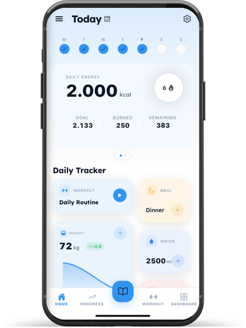 Today</td>
    <td align="center">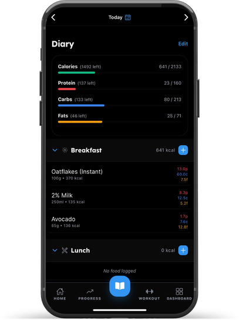 Food diary</td>
    <td align="center">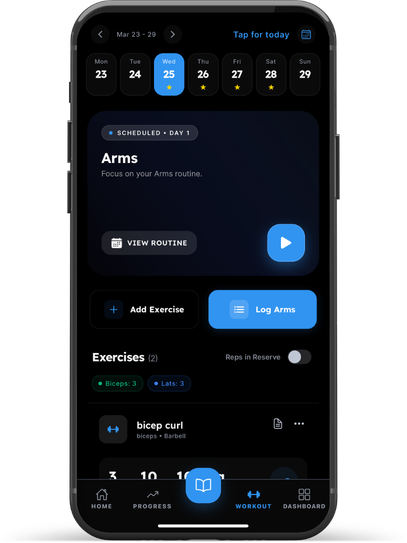 Workout logging</td>
    <td align="center">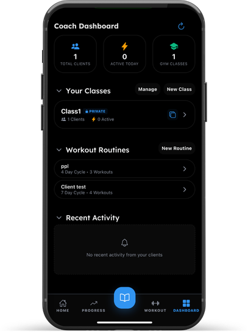 Coach view</td>
  </tr>
</table>

- **AI coach:** logs meals, workouts and sets from plain language ("I had two eggs and a coffee"), food photos and voice, using Gemini function calling.
- **Nutrition:** calorie and macro tracking, barcode scanning and a large searchable food database.
- **Training:** scheduled routines, one-tap set logging, Reps in Reserve, per-exercise progress history and GPS cardio tracking.
- **Coaching:** classes, challenges, routines assigned to clients and in-app messaging.
- **Integrations:** Apple Health / Health Connect, push notifications and subscriptions.

## Coach web dashboard

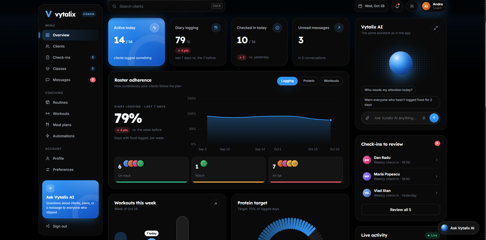

<table>
  <tr>
    <td>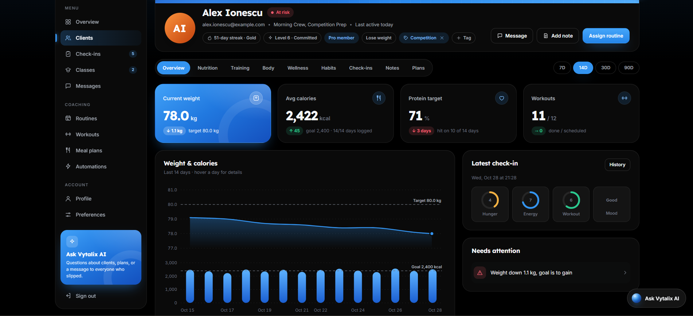 Client profile: weight, calories, check-ins and alerts</td>
    <td>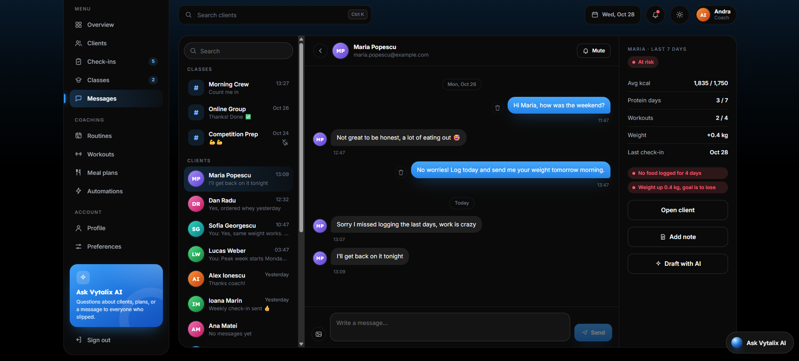 Messages with a live summary of the client's week</td>
  </tr>
  <tr>
    <td colspan="2">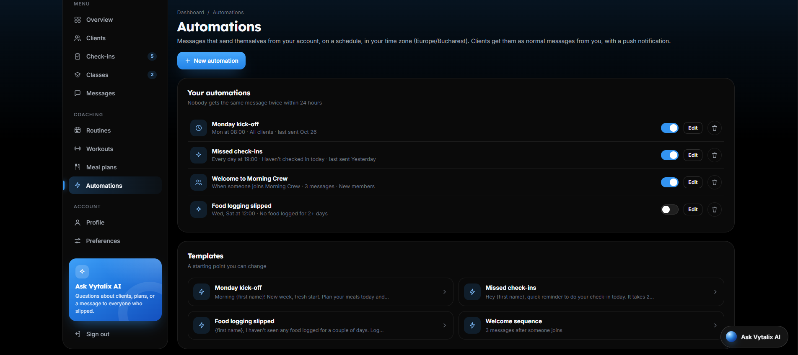 Automations: scheduled and rule-based messages to clients</td>
  </tr>
</table>

- Roster adherence, check-ins to review and clients at risk, at a glance.
- **Vytalix AI** answers questions about clients and drafts messages to everyone who slipped.

## Marketing website

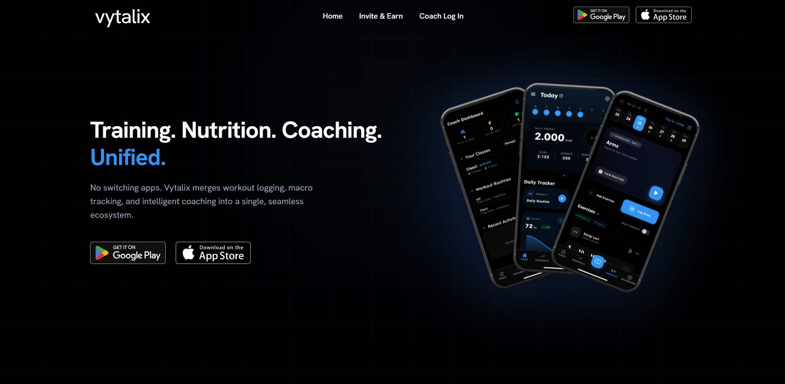

<table>
  <tr>
    <td>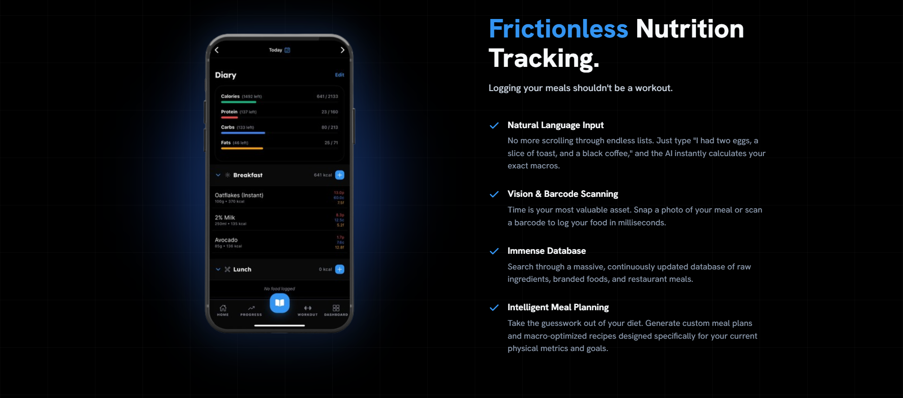</td>
    <td>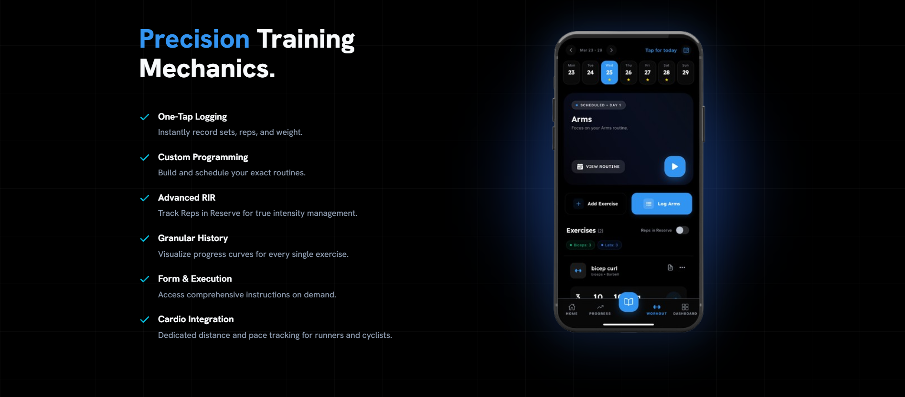</td>
  </tr>
  <tr>
    <td colspan="2">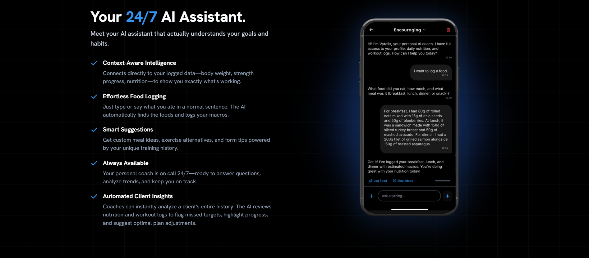</td>
  </tr>
</table>

The app is not published yet; the store badges on the website are placeholders.

## Tech stack

| Area | Technologies |
| --- | --- |
| Mobile | React Native (Expo), TypeScript, Zustand, React Navigation, Reanimated |
| Web | React, Vite, TanStack Query, Vitest |
| Backend | PostgreSQL with row-level security, Deno edge functions, REST APIs |
| AI | Google Gemini (function calling, vision, speech-to-text) |
| Search & caching | Meilisearch, Redis |
| Data | Node.js pipeline for USDA and brand food datasets, OpenFoodFacts barcode lookup |
| Services | RevenueCat, Apple HealthKit, Health Connect, Sentry, PostHog |
| Tooling | Jest, GitHub Actions, EAS Build |

## Architecture

- **No secrets on the device.** Every AI and third-party call goes through serverless edge functions that hold the keys.
- **Redis** caches repeated AI and search responses and enforces per-user rate limits and daily AI token budgets.
- **Offline-first client.** The UI updates instantly from a local cache and syncs with the backend in the background.
- **Layered codebase:** domain models, repository interfaces, implementations, services, then a single dependency-injection container that the UI depends on.

## Author

**Eric-Eduardo Vălean** · [GitHub](https://github.com/Eric-Valean) · [LinkedIn](https://www.linkedin.com/in/eric-eduardo-valean-6b8930336/)
